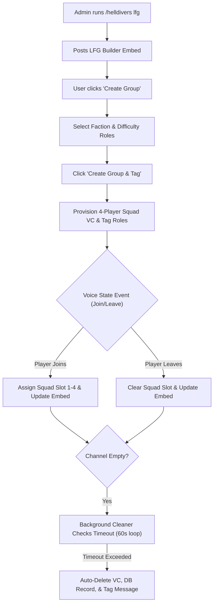

# Helldivers 2 LFG & Squad Voice Channel System

Dzhura D2 provides specialized tools for **Helldivers 2** communities. It automates 4-player squad formation, role-based pinging for target enemy factions and difficulty levels, real-time voice channel roster tracking, and automated background cleanup of abandoned channels.

---

## 📋 Overview & Features

* **Interactive LFG Builder:** Administrators post an interactive Helldivers LFG builder panel (`/helldivers lfg`).
* **Target Role Tagging:** Creators select target **Faction/Enemy Race** roles (e.g., Terminids, Automatons) and **Difficulty Level** roles (e.g., Suicidal, Helldive, Super Helldive) to notify squad candidates.
* **Dynamic 4-Player Voice Channels:** Automatically creates a 4-player voice channel under a dedicated category using custom naming templates.
* **Real-time Roster Embed Updates:** Monitors voice state events (`VoiceStateUpdate`) and dynamically updates player slots (`1`, `2`, `3`, `4`) in the message embed as players join or leave.
* **Automated Background Cleaner:** A background periodic timer monitors empty squad channels every 60 seconds and deletes channels that remain empty beyond the configured server timeout.



---

## 🛠️ Commands

### 1. `/helldivers lfg` (Admin Only)
Publishes the interactive **Helldivers LFG Builder** panel in the current channel containing the **"Create Group"** button.

### 2. `/helldivers clear <channel_id>` (Admin Only)
Clears all participant slots for the specified Helldivers voice channel and queues the channel for immediate automated removal.

---

## ⚙️ Group Creation Workflow

1. **Initiation:** A user clicks **"Create Group"** on the Helldivers LFG panel.
2. **Role Selection Dropdowns:**
   * **Faction / Race Role:** Selects enemy faction role (e.g., Terminids, Automatons).
   * **Difficulty / Level Role:** Selects difficulty tier role (e.g., Extreme, Suicide Mission, Impossible, Helldive).
3. **Provisioning:** Clicking **"Create Group and Tag"**:
   * Formats channel name based on template `vcName` (e.g., `{player} | {race} | {level}`).
   * Creates a dedicated 4-limit voice channel under category `vcCategory`.
   * Sends role ping notifications in the channel.

---

## 🔄 Real-time Voice State Roster Tracking

The bot listens to WebSocket voice events:
* **Joining (`actOnHelldiversVCEnter`):** When a user enters the squad voice channel, they are automatically placed into the next available slot (Slots 1 through 4), and the message embed is re-rendered displaying their user tag.
* **Leaving (`actOnHelldiversVCLeave`):** When a user leaves the channel, their slot is cleared and the message embed updates instantly.

---

## 🧹 Automated Background Channel Cleaner (`HelldiversVoiceChannelCleaner`)

To prevent voice channel clutter, Dzhura D2 runs an automated background cleaner task:

* **Check Interval:** Runs a periodic timer every **60 seconds**.
* **Empty Criteria:** Identifies channels where all 4 squad slots are empty (`{"1":"","2":"","3":"","4":""}`).
* **Server Timeout:** Checks if the empty duration exceeds `emptyVcTimeout` (Default: **600 seconds / 10 minutes**).
* **Cleanup Execution:** Once timed out, the bot:
  1. Deletes the Discord voice channel.
  2. Purges the `helldivers_lfg_voice_channels` database record.
  3. Deletes associated role tag messages.
  4. Re-renders the LFG embed to reflect channel removal.

---

## 🗄️ Database Schema (`helldivers_lfg_voice_channels` table)

```sql
CREATE TABLE helldivers_lfg_voice_channels (
    id BIGINT AUTO_INCREMENT PRIMARY KEY,
    guild_id VARCHAR(255) NOT NULL,
    lfg_channel_id VARCHAR(255) NOT NULL,
    lfg_message_id VARCHAR(255) NOT NULL,
    vc_discord_id VARCHAR(255) NOT NULL,
    tag_message_id VARCHAR(255) NULL,
    name VARCHAR(255) NOT NULL,
    participants JSON NOT NULL,
    created_at TIMESTAMP NULL,
    updated_at TIMESTAMP NULL
);
```
