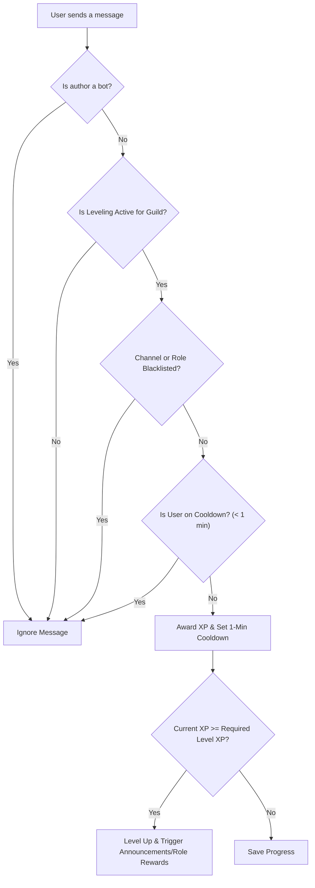

# Activity Leveling System

Dzhura D2 features a customizable, server-wide **Activity Leveling System**. It tracks member text engagement in Discord channels, awards experience points (XP) using anti-spam algorithms, handles level progression across 100 levels, awards automated Discord role rewards, and provides interactive leaderboard and rank commands.

---

## ⚙️ Core Architecture & Mechanics

### 1. Message Eligibility & Anti-Spam Cooldown
* **Eligible Messages:** XP is awarded only for human users sending standard messages (`TYPE_NORMAL`) or replies (`TYPE_REPLY`). Messages from Discord bots or system notifications are ignored.
* **1-Minute Cooldown:** To prevent chat spamming, earning XP puts the user on a **1-minute anti-spam cooldown** (`suspended` timestamp). Subsequent messages sent within 60 seconds do not award additional XP.



### 2. XP Calculation & Role Multipliers
* **Base XP Award:** Each eligible message grants a randomized base between **15** and **25** XP.
* **Global Server Rate:** Server administrators can configure a base XP rate percentage (e.g., 100% = default multiplier).
* **Role-Specific Rates:** Servers can define custom XP multipliers for specific Discord roles (e.g., VIPs or Patrons earn 150% XP).
* **Formula:**
  $$\text{XP Awarded} = \text{round}\left( \frac{\text{rand}(15, 25) \times \text{XP Rate}}{100} \right)$$

---

## 📈 Level Progression Curve (Levels 0 – 100)

The system supports levels from **0 to 100**. The XP required to advance increases progressively with each level.

### Milestone Progression Table

| Level | XP Required to Next Level | Total Cumulative XP |
| :--- | :--- | :--- |
| **0** | 100 | 0 |
| **1** | 155 | 100 |
| **5** | 475 | 1,150 |
| **10** | 1,100 | 4,675 |
| **20** | 3,100 | 23,850 |
| **30** | 6,100 | 67,525 |
| **40** | 10,100 | 145,700 |
| **50** | 15,100 | 268,375 |
| **75** | 31,975 | 835,375 |
| **100** | 55,100 | 1,899,250 |

---

## 🔔 Level-Up Announcements

When a user reaches a new level, the bot can publish an announcement message. Administrators can configure the announcement delivery channel:

* **Current Channel (`CURRENT_CHANNEL`):** Replies directly in the chat channel where the user sent the leveling message.
* **Direct Message (`PRIVATE_MESSAGE`):** Sends a private DM to the leveling user.
* **Custom Channel (`CUSTOM_CHANNEL`):** Posts to a specified dedicated announcement channel (e.g., `#level-ups`). Includes fallback handling if permissions are missing.
* **Disabled (`DISABLED`):** Suppresses level-up announcement messages.

### Message Template Placeholders
The announcement text is fully customizable and supports dynamic placeholders:
* `{player}` – Mentions the leveling user (`<@user_id>`).
* `{level}` – The user's new level number.

---

## 🏆 Role Rewards

Administrators can link specific Discord roles to level milestones (e.g., Level 5 = *Novice*, Level 20 = *Veteran*, Level 50 = *Legend*). 

The system supports two reward modes:

1. **Stack Previous Rewards (`STACK_PREVIOUS_REWARDS`):** Members keep all previously earned role rewards as they advance to higher levels.
2. **Remove Previous Rewards (`REMOVE_PREVIOUS_REWARDS`):** Automatically removes lower-tier role rewards when a member unlocks a higher-tier role reward, keeping role lists clean.

---

## 🚫 Channel & Role Exclusions

To maintain fair play, administrators can restrict where or by whom XP is earned:

* **No-XP Channels (`noXPChannels`):** Configure blacklisted channels (where XP is disabled) or whitelisted channels (only specified channels award XP).
* **No-XP Roles (`noXPRoles`):** Exclude specific member roles from earning XP.

---

## 🕹️ Slash Command Reference (`/levels`)

Users and administrators interact with the leveling system using the `/levels` slash command:

| Command | Usage | Description |
| :--- | :--- | :--- |
| `/levels rank [member]` | Public | Displays a user's current rank card embed (level, current XP, total XP, message count, progress bar, and global position). Includes a button to dismiss the card. |
| `/levels leaderboard` | Public | Opens an interactive, paginated server leaderboard displaying top members sorted by level/XP with **Next**, **Previous**, and **Dismiss** controls. |
| `/levels table` | Public | Displays the complete level requirement table. |
| `/levels give-xp <member> <amount>` | Admin Only | Grants a specified amount of XP to a member and handles automated level-up calculations and role rewards. |
| `/levels remove-xp <member> <amount>` | Admin Only | Deducts a specified amount of XP from a member. |

---

## 🗄️ Database Schema (`levels` table)

Leveling progress is stored in the database under the `levels` table:

```sql
CREATE TABLE levels (
    id BIGINT AUTO_INCREMENT PRIMARY KEY,
    guild_id VARCHAR(255) NOT NULL,
    user_id VARCHAR(255) NOT NULL,
    level INT DEFAULT 0,
    xp_current INT DEFAULT 0,
    xp_total INT DEFAULT 0,
    messages INT DEFAULT 0,
    suspended TIMESTAMP NULL,
    created_at TIMESTAMP NULL,
    updated_at TIMESTAMP NULL
);
```
