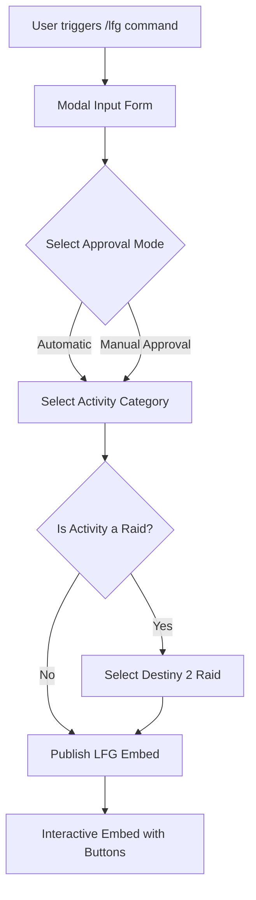

# Destiny 2 LFG (Looking For Group) System

The **LFG system** in Dzhura D2 is designed specifically for **Destiny 2** fireteam creation, participant queueing, and voice channel orchestration. It provides interactive Discord modal forms, multi-step activity categorization, participant queue management (primary and reserve slots), automated DM approval flows, and dynamic voice channel provisioning.

---

## 📋 Overview & Command Flow

The primary command to initiate a fireteam request is `/lfg`.

---

## 🛠️ Step 1: LFG Creation Form (Modal)

When `/lfg` is executed, Discord displays an interactive modal input form requiring four inputs:

1. **Activity Name (`activity_name`):** Title of the activity or fireteam goal (e.g., *"Master Salvation's Edge Fresh Run"*).
2. **Activity Description (`description`):** Detailed rules, loadouts, requirements, or notes (e.g., *"KWTD, bring Gjallarhorn, chill run"*).
3. **Start Date & Time (`date`):** Time formatted as `H:i d m` (Hours:Minutes Day Month in 24-hour format).
   * *Example inputs:* `20:00 15 7` (July 15 at 20:00), `9:30 4 12` (December 4 at 09:30).
4. **Group Size (`group_size`):** Total required player capacity (1 to 42 players).

---

## ⚙️ Step 2: Participation Approval Modes

After submitting the modal form, the event creator selects how applicants will join the fireteam:

* **Automatic Mode:** Any player who clicks the **Join ("I Want to Go")** button is immediately accepted into an active fireteam slot (until capacity is reached).
* **Manual Approval Mode:** When a player requests to join, the event creator receives a direct message (DM) from the bot containing **Approve** and **Decline** buttons. The applicant is only added to the main fireteam queue once explicitly approved by the creator.

---

## 🎯 Step 3: Destiny 2 Activity Categories & Raid Support

The creator selects the Destiny 2 activity type. Embeds are styled with custom Bungie artwork, colors, and thumbnails based on the selection:

### 1. Raids (`raid`)
If **Raid** is chosen, a drop-down menu opens to select the specific Destiny 2 Raid:

| Raid Abbreviation | Full Destiny 2 Raid Name |
| :--- | :--- |
| **SE** | Salvation's Edge |
| **CE** | Crota's End |
| **RON** | Root of Nightmares |
| **KF** | King's Fall |
| **VOD** | Vow of the Disciple |
| **VOG** | Vault of Glass |
| **DSC** | Deep Stone Crypt |
| **GOS** | Garden of Salvation |
| **LW** | Last Wish |

### 2. PVP (`pvp`)
* Designed for Crucible, Trials of Osiris, Iron Banner, and Competitive fireteams.

### 3. PVE (`pve`)
* Designed for Nightfalls (Grandmaster/Heroic), Dungeons, Exotic Missions, Campaign runs, and Seasonal activities.

### 4. Gambit (`gambit`)
* Designed for Gambit fireteams.

### 5. Other (`other`)
* Custom or miscellaneous Destiny 2 activities.

---

## 🔘 Step 4: Interactive Embed Controls & Buttons

Once created, the bot posts an interactive message embed in the channel with real-time buttons for server members:

| Button Icon / Name | Action & Functionality |
| :--- | :--- |
| 🟢 **Join ("I Want to Go")** | Registers the user as an active participant in the main fireteam queue if open slots remain. |
| 🔵 **Reserve** | Registers the user in the backup reserve queue when main slots are filled or preferred as backup. |
| ⚪ **Remove Registration** | Removes the user from either the active participant list or the reserve queue. |
| 🗑️ **Delete Group** | Cancels the event and deletes the LFG post (Restricted to creator or server admins). |
| `#️⃣` **Tag Participants** | Pings all current fireteam participants in the channel to grab attention before launch. |
| 🔊 **Voice Channel** | Dynamically creates or binds a dedicated temporary voice channel for the fireteam. |

---

## ✏️ Modifying & Deleting LFGs

### Editing an LFG (`/lfg edit`)
The creator can modify an active LFG post post-creation to update:
* Event title & description
* Scheduled date and start time
* Fireteam capacity size

### Automated Cleanup & Deletion
* **Manual Deletion:** Clicking the 🗑️ **Delete Group** button deletes the database records (`Lfg`, `Participant`, `Reserve`, `VoiceChannel`) and removes the embed.
* **Message Removal:** Deleting the LFG embed message directly triggers `LfgDeleteSlashCommandListener` to purge related database entries and clean up linked voice channels.
