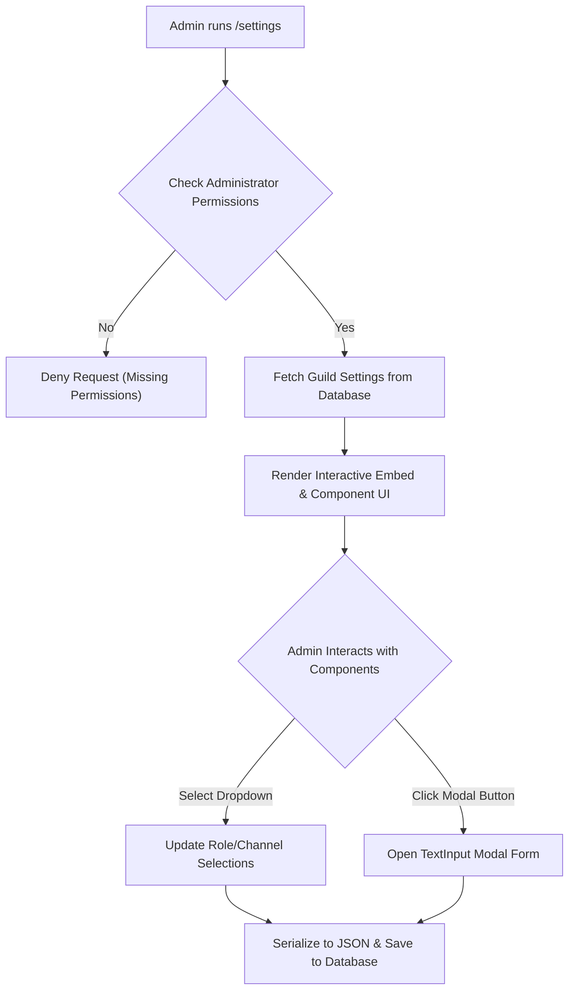

# Settings Management System

Dzhura D2 features an interactive, per-guild **Settings Management System** (`/settings`). Server administrators can configure bot behaviors across all subsystems - including global timezones, dynamic voice channels, leveling rules, Destiny 2 LFG pings, Helldivers 2 squad channels, and server audit logging - using Discord embeds, select dropdown menus, and modal dialogs.

---

## 📋 Overview & Storage Architecture

* **Database Persistence:** Server configurations are serialized as JSON objects in the `settings` table, indexed by `guild_id`.
* **Access Control:** Restricted strictly to server members with **Administrator** permissions.
* **Interactive UI:** Built using Discord Action Rows, Multi-Select Menus (`SelectMenuRoles`, `SelectMenuChannels`), and Modals for text/numeric inputs.



---

## 🕹️ Sub-Command Categories & Options

### 1. Global Settings (`/settings global`)
Configures server-wide regional preferences.

| Configuration Field | Data Type | Default | Description |
| :--- | :--- | :--- | :--- |
| `timeZone` | String | `UTC` | Server time zone used for LFG event scheduling and timestamps. |

---

### 2. Dynamic Voice Channel Settings (`/settings voicecreate`)
Controls rules and limits for user-created voice channels (`/voicecreate`).

| Configuration Field | Data Type | Default | Description |
| :--- | :--- | :--- | :--- |
| `permittedRoles` | Array | `[]` | List of Discord role IDs authorized to create custom voice channels. Empty array permits all members. |
| `defaultCategory` | String | `"База Азова"` | Default Discord category name where new voice channels are placed. |
| `channelLimit` | Integer | `1` | Maximum number of active custom voice channels a non-admin user can own simultaneously. |

---

### 3. Leveling System Settings (`/settings levels`)
Manages the Activity Leveling System rules, rewards, and announcements.

| Configuration Sub-Category | Options / Fields | Description |
| :--- | :--- | :--- |
| **Activation** | `active` (Boolean) | Toggles the activity leveling system on or off for the server (Default: `false`). |
| **XP Rates** | `xpRate`, `roleSpecificRate` | Configures global base XP multiplier and role-specific bonus XP rates. |
| **Announcements** | `channel`, `announcementMessage`, `customChannel` | Delivery mode (`CURRENT_CHANNEL`, `PRIVATE_MESSAGE`, `CUSTOM_CHANNEL`, `DISABLED`) and message templates with `{player}` and `{level}` placeholders. |
| **Role Rewards** | `roleRewards`, `roleRewardsType` | Maps levels to Discord roles. Rewards mode supports `STACK_PREVIOUS_REWARDS` or `REMOVE_PREVIOUS_REWARDS`. |
| **Exclusions** | `noXPChannels`, `noXPRoles` | Blacklist or whitelist text channels and roles excluded from earning XP. |

---

### 4. Destiny 2 LFG Settings (`/settings lfg`)
Configures default notification behavior for Destiny 2 LFG posts (`/lfg`).

| Configuration Field | Data Type | Default | Description |
| :--- | :--- | :--- | :--- |
| `isRolesToTagActive` | Boolean | `false` | Toggles automatic role tagging upon LFG post creation. |
| `rolesToTag` | Array | `[]` | List of Discord role IDs automatically pinged when an LFG post is published. |

---

### 5. Helldivers 2 Settings (`/settings helldivers`)
Configures squad voice channels and role pings for Helldivers 2 LFG (`/helldivers lfg`).

| Configuration Field | Data Type | Default | Description |
| :--- | :--- | :--- | :--- |
| `vcCategory` | String | `"Helldivers LFG"` | Category name where 4-player Helldivers squad voice channels are created. |
| `vcName` | String | `"Група === {player} ==="` | Squad channel naming template supporting `{player}`, `{race}`, and `{level}` placeholders. |
| `emptyVcTimeout` | Integer | `600` | Timeout in seconds (default 10 mins) before empty channels are auto-deleted. |
| `permittedRoles` | Array | `[]` | Roles authorized to create Helldivers squads. |
| `racesRoles` | Array | `[]` | Selectable enemy faction roles (e.g. Terminids, Automatons). |
| `levelsRoles` | Array | `[]` | Selectable difficulty level roles (e.g. Helldive, Super Helldive). |

---

### 6. Server Audit Logs Settings (`/settings server-logs`)
Configures guild event auditing and logging (`ServerLogsService`).

| Configuration Field | Data Type | Default | Description |
| :--- | :--- | :--- | :--- |
| `active` | Boolean | `false` | Enables or disables server audit logging. |
| `logChannel` | String | `null` | Channel ID where server audit log embeds are published. |
| `events` | Array | `[]` | Enabled log event types (member updates, voice state changes, member bans, message deletions). |

---

## 🗄️ Database Schema (`settings` table)

Settings are persisted in the `settings` table:

```sql
CREATE TABLE settings (
    id BIGINT AUTO_INCREMENT PRIMARY KEY,
    guild_id VARCHAR(255) NOT NULL UNIQUE,
    object JSON NOT NULL,
    created_by VARCHAR(255) NOT NULL,
    updated_by VARCHAR(255) NULL,
    created_at TIMESTAMP NULL,
    updated_at TIMESTAMP NULL
);
```

### Example Deserialized JSON Payload (`SettingsDefaultObject`)

```json
{
  "global": {
    "timeZone": "UTC"
  },
  "vc": {
    "permittedRoles": [],
    "defaultCategory": "База Азова",
    "channelLimit": 1
  },
  "levels": {
    "active": false
  },
  "lfg": {
    "isRolesToTagActive": false,
    "rolesToTag": []
  },
  "helldivers": {
    "vcCategory": "Helldivers LFG",
    "vcName": "Група === {player} ===",
    "emptyVcTimeout": 600,
    "permittedRoles": [],
    "racesRoles": [],
    "levelsRoles": []
  },
  "serverLogs": {
    "active": false
  }
}
```
