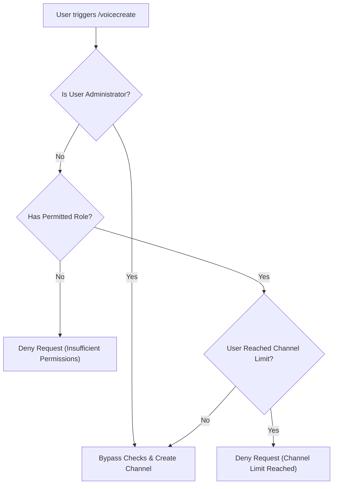

# Dynamic Voice Channel Management System

Dzhura D2 includes a dynamic **Voice Channel Management System** (`/voicecreate`, `/voiceedit`, `/voicedelete`) that enables server members and administrators to provision, customize, and delete temporary custom voice channels with custom user limits and category assignments.

---

## 📋 Overview & Features

* **Custom Channel Creation (`/voicecreate`):** Create custom voice channels specifying name, user limits, category, and optional LFG binding.
* **Modal Channel Editing (`/voiceedit`):** Edit channel name and user limits via an interactive Discord modal interface.
* **Channel Deletion (`/voicedelete`):** Delete custom voice channels and purge database records.
* **Role Permissions & Per-User Limits:** Enforces role permissions (`permittedRoles`) and per-user active channel limits (`channelLimit`).
* **LFG Integration:** Option to bind custom voice channels directly to active LFG events.

---

## 🕹️ Commands Reference

### 1. `/voicecreate`
Creates a new dynamic voice channel.

| Option | Type | Required | Description |
| :--- | :--- | :--- | :--- |
| `name` | String | **Yes** | The name of the voice channel. |
| `user_limit` | Integer | **Yes** | Maximum user capacity (minimum: 1). |
| `category` | String | Optional | Target Discord category name (defaults to server `defaultCategory`). |
| `lfg_id` | String | Optional | UUID of an active LFG event to bind this voice channel to. |

### 2. `/voiceedit [id]`
Edits an existing voice channel.

* **Modal Form:** Displays interactive text fields for **Channel Name** and **User Limit**.
* **Target:** Edits the channel specified by `id` or the current channel where the command was executed.
* **Authorization:** Only the **channel owner** (creator) or a server **Administrator** can edit the channel.

### 3. `/voicedelete [id]`
Deletes a dynamic voice channel.

* **Target:** Deletes the channel specified by `id` or the current channel where the command was executed.
* **Authorization:** Only the **channel owner** (creator) or a server **Administrator** can delete the channel.
* **Cleanup:** Removes the channel from Discord and deletes the corresponding record from the `voice_channels` table.

---

## 🛡️ Permissions & Channel Limits



1. **Role Restrictions (`permittedRoles`):** If configured in server settings, non-admin users must possess at least one permitted role to execute `/voicecreate`.
2. **Channel Capacity Limit (`channelLimit`):** Limits the number of active custom voice channels a single non-admin user can own simultaneously.

---

## 🗄️ Database Schema (`voice_channels` table)

Dynamic voice channels are tracked in the database under the `voice_channels` table:

```sql
CREATE TABLE voice_channels (
    id BIGINT AUTO_INCREMENT PRIMARY KEY,
    guild_id VARCHAR(255) NOT NULL,
    vc_discord_id VARCHAR(255) NOT NULL,
    owner VARCHAR(255) NOT NULL,
    name VARCHAR(255) NOT NULL,
    user_limit INT NOT NULL DEFAULT 0,
    category VARCHAR(255) NULL,
    lfg_id BIGINT NULL,
    created_at TIMESTAMP NULL,
    updated_at TIMESTAMP NULL,
    FOREIGN KEY (lfg_id) REFERENCES lfgs(id) ON DELETE CASCADE
);
```
